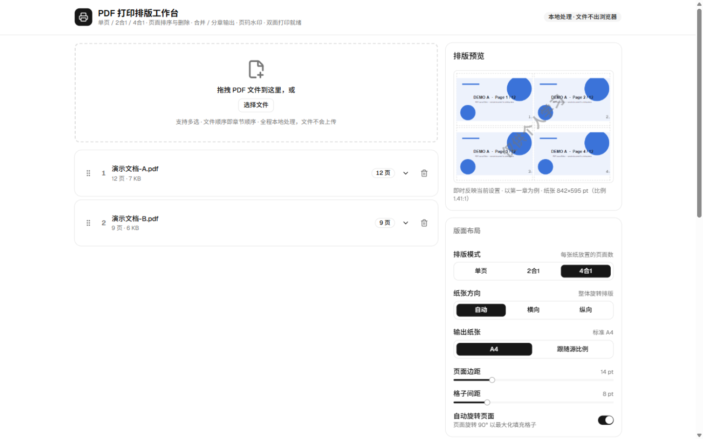
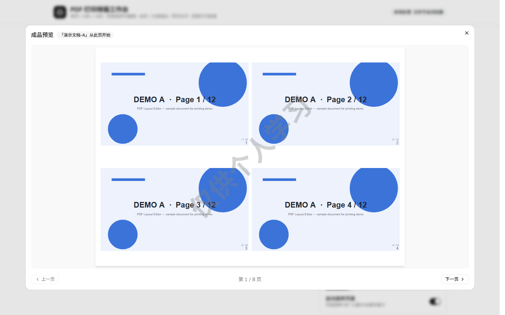
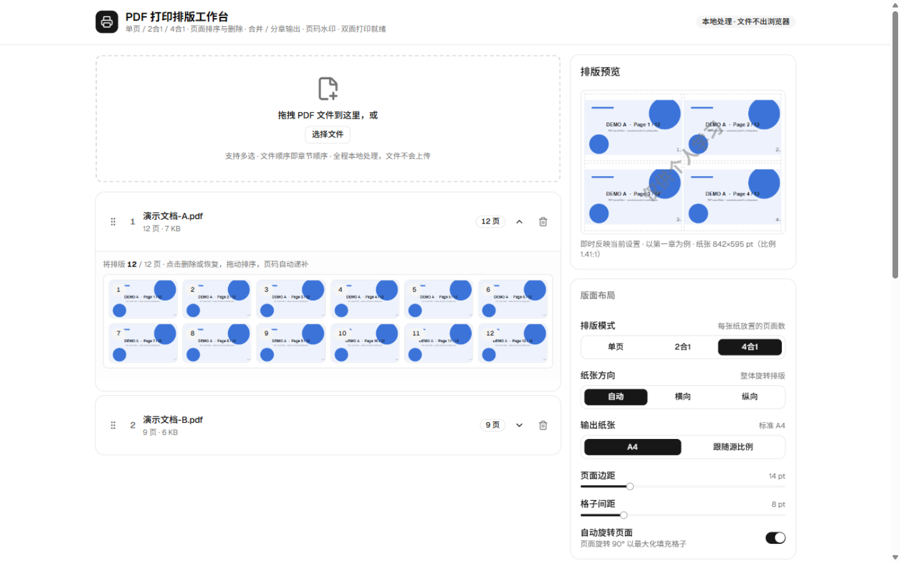

# PDF 打印排版工作台

[](https://github.com/handsometaoa/PDFLayoutEditor/actions/workflows/ci.yml)

浏览器本地 PDF 打印排版工具：把多份 PDF 课件按「单页 / 2合1 / 4合1」排到打印纸上，支持章节合并、页面排序与删除、奇数章补空白页，一键生成双面打印就绪的 PDF。

**全程在浏览器本地处理，文件不会上传到任何服务器。**

## 截图预览

| 主界面（即时排版预览 + 分类设置） | 成品预览（页码 + 水印） |
|---|---|
|  |  |

| 页面管理（删除 / 拖拽排序 / 自动递补） |
|---|
|  |

## 在线使用

推送 `main` 分支后，GitHub Actions 会自动构建并部署到 GitHub Pages：

**https://handsometaoa.github.io/PDFLayoutEditor/**

（首次部署需等 Actions 运行完成；也可在仓库 Actions 页面手动触发「Deploy to GitHub Pages」。）

## 功能特性

- **排版模式**：单页 / 2合1 / 4合1（每张纸放置的页面数）
- **整体旋转排版**：纸张方向自动 / 横向 / 纵向，页面自动旋转 90° 最大化填充格子
- **输出纸张**：标准 A4，或跟随源页面比例
- **页面管理**：缩略图网格中点选删除 / 恢复、拖拽（或键盘）排序，页码自动递补
- **章节合并**：多份 PDF 按顺序合并为一个 PDF，或各章单独输出
- **双面打印就绪**：奇数章自动补空白页（仅双面打印时可选），保证每章从纸张正面开始、一张纸不出现两章内容
- **页面序号**：每格右下角标注章节内页码
- **水印**：自定义文字水印，斜向半透明铺满整页
- **即时排版预览**：设置变化实时反映到第一张成品的排布（真实页面缩略图）
- **成品预览**：生成后逐页预览，标注章节起始页，多文件输出可切换
- **打印指引**：界面内提示双面打印的正确设置，并附常见品牌官方说明书直达入口
- **设置自动记忆**：关闭页面后再打开，仍保留上次的排版选择

## 快速开始

```bash
npm install
npm run dev        # 开发模式：http://localhost:5173
npm run build      # 生产构建（输出到 dist/）
npm run preview    # 本地预览生产构建
npm test           # 单元测试（vitest）
```

> 要求 Node.js ≥ 20.19（Vite 8）。构建产物为纯静态站点，可部署到任意静态托管。

## 打印建议

1. 双面打印请选择「**短边翻转** / 短边装订」——横向页面用「长边翻转」会导致背面颠倒
2. 缩放选择「**实际大小 100%**」，不要再选「每张多页」（排版已完成）
3. 纸张方向保持「自动」或横向

## 技术实现

- **技术栈**：Vite + React 19 + TypeScript + Tailwind CSS v4 + shadcn/ui + zustand + dnd-kit
- **排版引擎**：pdf-lib 在 Web Worker 中完成矢量排版，不降画质
  - 手动补偿 PDF `/Rotate` 查看器旋转属性（pdf-lib 不感知，见 `imposition.ts` 补偿矩阵与单测）
  - 单次 `copyPages` 让字体 / 图片等资源跨页共享，再嵌入文档内副本页——避免逐格深拷贝资源导致输出体积膨胀（实测 82 MB → 14 MB）
- **渲染预览**：pdf.js（`standard_fonts` / `cmaps` 已本地化到 `public/pdfjs/`，离线可用）
- **水印**：OffscreenCanvas 将文字渲染为透明 PNG 后整页铺放，支持中文且无需嵌入字体
- **即时预览**：与生成共用同一套几何计算（`computeSheet` / `gridCells` / `fitPage`），预览即所得
- **测试**：vitest 覆盖网格几何、`/Rotate` 补偿矩阵各角度与真实文件端到端校验（双面规则、体积上限）

## 目录结构

```
src/
├── lib/
│   ├── pdf/
│   │   ├── layout.ts        # 纯几何计算：网格切分、页面适配、纸张方向选择
│   │   ├── imposition.ts    # /Rotate 补偿 + drawPage 参数推导
│   │   ├── merge.ts         # 合并构建：补空白页、页码、水印
│   │   ├── load.ts          # 加载与加密检测
│   │   └── rotate.smoke.test.ts
│   ├── worker/
│   │   └── imposition.worker.ts   # Web Worker：排版任务与进度消息
│   ├── workerClient.ts      # 主线程 Worker 封装
│   └── pdfjs.ts             # pdf.js 配置与文档缓存
├── store.ts                 # zustand 全局状态
├── hooks/                   # 缩略图懒渲染
└── components/              # 上传 / 文件列表 / 页面网格 / 设置 / 预览等 UI
```

## 隐私

所有处理均在浏览器内完成（排版在 Web Worker 中执行），PDF 文件不经过任何网络请求。
